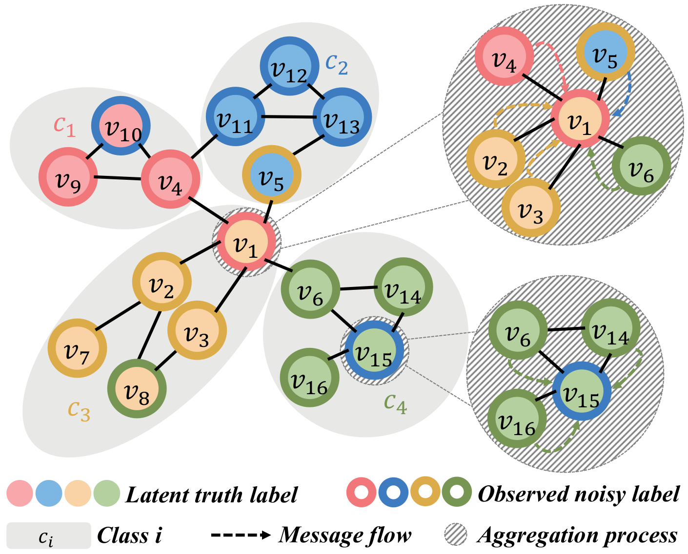

# Topological Label Refinement (TLR)

Code for the paper "Learning with Label Noise on Graphs: A Topological Label Refinement Method".

<p align="center">
  
</p>

Illustration of noisily labeled nodes in different topological structures: v<sub>1</sub> is a mislabeled node located
near class boundaries, while v<sub>15</sub> is a mislabeled node far away from class boundaries.

## Requirements

Python 3.11, PyTorch 2.0.1, PyTorch Geometric 2.5.1, NumPy, SciPy, and `ogb` for ogbn-arxiv.

```bash
pip install -r requirements.txt
```

## Usage

```bash
python main.py --dataset cora --noise_type sym --noise_rate 0.3
```

`--dataset` is one of `cora`, `citeseer`, `pubmed`, `wikics`, `facebook`, `physics`, `dblp`, `arxiv`;
`--noise_type` is `sym`, `pair` or `idn`.
The default hyper-parameters are listed at the top of `main.py`; each of them can be set on the command line, for
example `--lr 0.01 --hidden 128 --T 400`.

The script prints the test accuracy of every run and the mean and standard deviation over the runs (`--runs`), both
at the last epoch and at the epoch with the best validation accuracy.
Message passing on the GPU uses non-deterministic scatter operations, so repeated runs differ slightly.

## Data

No data files are shipped with the code. Each dataset is downloaded on first use and stored in `--data_dir`
(default `./dataset`); the label noise and the PPR matrix are computed from it.

| Dataset | Source | Split |
|---|---|---|
| Cora, CiteSeer, PubMed | `torch_geometric.datasets.Planetoid` | full Planetoid split |
| WikiCS | `torch_geometric.datasets.WikiCS` | first of the public training/validation splits |
| Facebook | `torch_geometric.datasets.FacebookPagePage` | random: 100 training nodes per class, 500 validation and 1,000 test nodes |
| Physics | `torch_geometric.datasets.Coauthor` | random: 100 training nodes per class, 500 validation and 1,000 test nodes |
| DBLP | `torch_geometric.datasets.CitationFull` | random: 200 training nodes per class, 500 validation and 1,000 test nodes |
| ogbn-arxiv | `ogb.nodeproppred.PygNodePropPredDataset` | official OGB split |

- **Features.** The features of Cora, CiteSeer, PubMed and Facebook are row-normalised; the ogbn-arxiv graph is made
  undirected.
- **Label noise** (`noise.py`). Symmetric, pair or instance-dependent noise with rate `--noise_rate` is added to the
  training labels with a fixed seed. The validation labels are noisy as well (same rate on Cora, CiteSeer and PubMed,
  10% on the other datasets); the test labels are clean.
- **PPR** (`utils.py`). The exact PPR matrix is used for all graphs except ogbn-arxiv, for which the 128 largest
  entries per node of a 30-step power iteration are kept. It is computed once and cached in `--data_dir`. The dense
  PPR matrices of WikiCS, Facebook, Physics and DBLP are computed on the CPU; for Physics (34,493 nodes) this takes
  about 9 minutes and 30 GB of RAM.

## Files

| File | Content |
|---|---|
| `main.py` | pre-training, curriculum over the CBC ranking, enhanced model, label refinement |
| `utils.py` | PPR, class-conditional betweenness centrality, pacing function, evaluation |
| `data.py` | dataset download, splits and noisy labels |
| `noise.py` | symmetric, pair and instance-dependent label noise |
| `model.py` | GCN |
